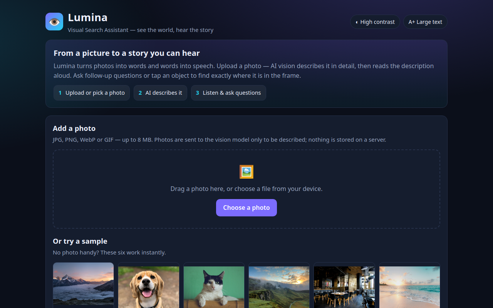
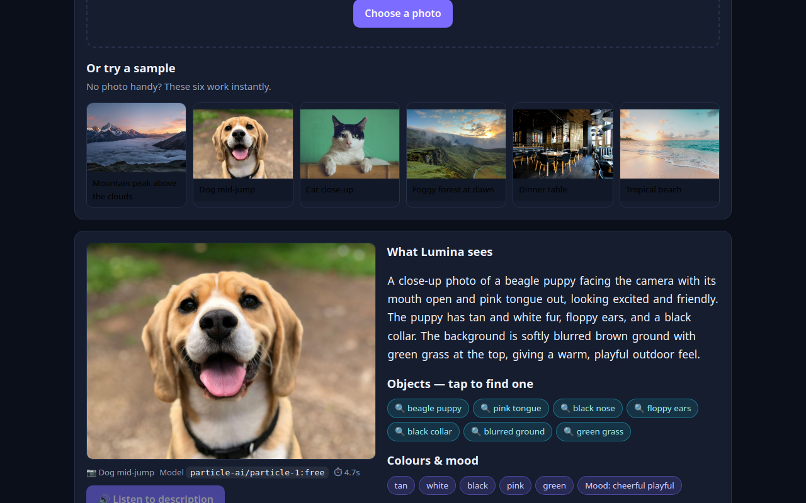
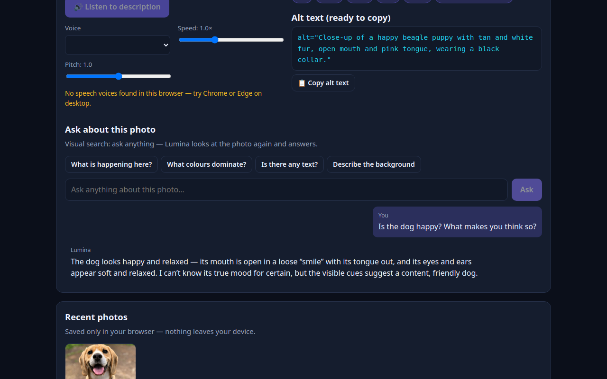
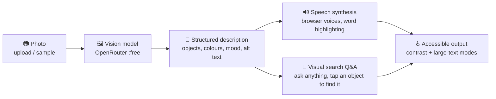

# Lumina — Visual Search Assistant

> **Upload a photo. Hear its story. Ask it anything.**
>
> Built for the **StackUp November Coding Challenge** — Theme: *From Words to
> Worlds (Multimodal GenAI)*, **Challenge Statement 2: Create a Visual Search
> Assistant** (image-to-text + speech synthesis, built for accessibility).

🎥 **Demo video (29 s):** [`docs/demo-video.mp4`](docs/demo-video.mp4) · [YouTube](https://www.youtube.com/watch?v=U9jPT5BgaGw) — pick a sample photo → live AI description → ask a follow-up question.



## What it does

Lumina turns a photo into words, and words into speech. It is designed for
people who cannot see a photo — and for anyone who wants to search inside one.

1. **See** — Upload a photo (drag & drop or file picker) or tap one of the six
   built-in sample photos. AI vision describes it in detail: a 2–3 sentence
   description, the main objects, dominant colours, the mood, and a
   ready-to-copy HTML `alt` text.
2. **Hear** — The description is read aloud with your browser's built-in
   speech synthesis (free, no key, no network). Pick a voice, speed and pitch;
   words highlight as they are spoken. Pause, resume and stop are supported.
3. **Ask** — Visual search: ask anything about the photo and Lumina looks at
   it again and answers ("Is the dog happy?", "What colours dominate?"). Tap
   any detected object chip to find exactly where that object is in the frame.
4. **Remember** — Recent photos are kept in your browser (localStorage) so you
   can re-open an earlier analysis. Nothing is ever stored on a server.





## How the modalities interact



| Modality | Technology | Cost |
|---|---|---|
| Image → text | OpenRouter free-tier vision models (see failover table) | $0 |
| Text → speech | Web Speech API (`speechSynthesis`, built into the browser) | $0 |
| Text → text (Q&A) | Same vision models, with the photo + chat history | $0 |

No paid API, no key that costs money, no audio files — the whole loop runs
on free tiers.

## Vision models — automatic failover

Free-tier vision models on OpenRouter share one upstream rate-limit pool, so
any single model can answer `429` at any moment. Lumina walks a priority
chain until a model answers, and shows which model was used and how many
attempts it took. Verified live on 2026-11-22:

| Priority | Model | Observed |
|---|---|---|
| 1 | `particle-ai/particle-1:free` | Richest descriptions; ~2.3–4.7 s when the pool is clear; 429 when congested |
| 2 | `nvidia/nemotron-3-nano-omni-30b-a3b-reasoning:free` | Accurate; ~3.5–3.7 s; reasoning model — output is salvaged if its JSON is truncated |
| 3 | `google/gemma-4-31b-it:free` | Gemini-family vision; 429 during the 22 Nov test window |
| 4 | `google/gemma-4-26b-a4b-it:free` | Gemini-family vision; 429 during the 22 Nov test window |
| 5 | `inclusionai/ling-3.2-flash:free` | Last resort; 429 during the 22 Nov test window |

`nvidia/nemotron-3.5-super-vl:free` was tested and dropped: its endpoints do
not accept image URLs (HTTP 404). Groq was tested first and has **no vision
model** on this key, so it is not used.

If a model returns malformed or truncated JSON, the server salvages the fields
one by one (regex extraction) instead of showing raw JSON to the user.

## Quick start

```bash
git clone https://github.com/jajanb923-netizen/lumina-visual-search-assistant
cd lumina-visual-search-assistant
npm install

# 1. Get a FREE key at https://openrouter.ai/keys (no credit card)
# 2. Copy .env.example to .env.local and paste the key:
cp .env.example .env.local   # then set OPENROUTER_API_KEY

npm run dev    # http://localhost:3000
```

Production build:

```bash
npm run build
npm start      # http://localhost:3000
```

### Deploy

Deploy anywhere Next.js runs. On **Vercel**: import the repo, add the
`OPENROUTER_API_KEY` environment variable, deploy. No other configuration is
needed. The app also runs with `docker` behind any Node 20+ runtime.

## Project structure

```
src/
  app/
    layout.tsx            # metadata + root layout
    page.tsx              # the whole UI: upload, results, speech, Q&A, history
    globals.css           # theme, high-contrast + large-text modes
    api/
      analyze/route.ts    # POST { imageDataUrl } → structured analysis
      ask/route.ts        # POST { imageDataUrl, question, history } → answer
  lib/
    openrouter.ts         # model failover chain, JSON extract + salvage
    samples.ts            # the six built-in sample photos
    speech.ts             # Web Speech API wrapper (voices, speak-along)
    history.ts            # localStorage history (max 8, thumbnails only)
public/samples/           # six curated photos (Unsplash, free licence)
docs/                     # screenshots + 29 s demo video
```

## Measured performance (22 Nov 2026, live runs)

| Measurement | Result |
|---|---|
| `POST /api/analyze` (cat photo, 1 failover) | 8.1 s end-to-end |
| `POST /api/analyze` (cat photo, direct) | 2.4 s |
| `POST /api/analyze` (dog photo, direct) | 4.7 s |
| `POST /api/ask` (1 failover) | 6.2 s |
| Production build | clean, TypeScript strict, 0 errors |
| First Load JS | 108 kB |
| Image handling | client-side downscale to max 1024 px before upload; 8 MB cap |

Reliability notes from testing: the free-model pool is bursty (all three
Gemini/Ling models 429'd within minutes of each other, then cleared). The
failover chain + 20 s per-attempt timeout is what keeps the app answering.
Per-attempt timeouts were cut from 45 s to 20 s after the first demo run
timed out on a congested pool.

## Accessibility

- **High-contrast mode** and **large-text mode** toggles in the header.
- Speak-along word highlighting while the description is read aloud.
- Full keyboard operability; labelled controls; `aria-live` description
  region; `prefers-reduced-motion` respected.
- Copy-ready `alt` text for every analysed photo.

## Known limitations

- Speech needs a browser with speech voices (desktop Chrome/Edge work;
  headless browsers report "no voices" and the Listen button stays disabled).
- The free vision pool is rate-limited at peak times; the app fails over
  automatically, but an answer can take up to ~20 s when the pool is busy.
- Photos are capped at 8 MB and downscaled to 1024 px before upload.

## License

MIT — see [LICENSE](LICENSE). Sample photos: Unsplash (free licence).
